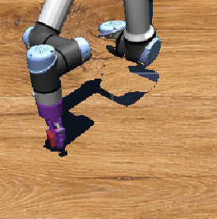
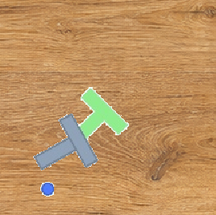
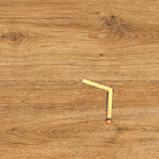
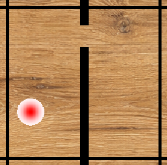

# MotionJEPA

Official code for **MotionJEPA: Preventing Temporal Feature Collapse by Capturing Visual Changes in Latent Space**. This release contains the paper's downstream robustness experiments on the four LeWorldModel benchmarks with a static wood-texture distractor: OG-Cube, PushT, Reacher, and TwoRooms.

## Wood-texture benchmarks

Each rollout uses a different crop of the wood texture as a static visual distractor; the crop remains fixed throughout that rollout.

|                                                        OG-Cube                                                         |                                                         PushT                                                         |                                                          Reacher                                                          |                                                          TwoRooms                                                          |
| :--------------------------------------------------------------------------------------------------------------------: | :-------------------------------------------------------------------------------------------------------------------: | :-----------------------------------------------------------------------------------------------------------------------: | :------------------------------------------------------------------------------------------------------------------------: |
|  |  |  |  |

## Main downstream results

Planning success rate (%) with a different wood crop per rollout, fixed within that rollout. CEM uses a five-model-step horizon with frame skip 5: 300 candidate action sequences, 30 elites, and 30 optimization iterations. For the 50-step setting, we keep the 25-step CEM setup unchanged except for doubling the planning budget, resulting in doubled number of plannings over the trajectory.

### 25-step planning

| Method        | OG-Cube | PushT | Reacher | TwoRooms | Mean |
| ------------- | ------: | ----: | ------: | -------: | ---: |
| Original LeWM |    43.6 |   4.0 |     5.2 |     28.8 | 20.4 |
| LeWM-Flat     |    55.2 |  14.4 |    49.2 |     48.0 | 41.7 |
| IDM           |    76.0 |  83.6 |    49.2 |    100.0 | 77.2 |
| Ours          |    78.0 |  78.4 |    71.2 |     99.6 | 81.8 |
| Ours + IDM    |    80.8 |  82.4 |    82.4 |    100.0 | 86.4 |

### 50-step planning

| Method        | OG-Cube | PushT | Reacher | TwoRooms | Mean |
| ------------- | ------: | ----: | ------: | -------: | ---: |
| Original LeWM |    24.4 |   2.4 |     2.0 |     18.4 | 11.8 |
| LeWM-Flat     |    42.4 |   2.0 |    60.4 |     22.8 | 31.9 |
| IDM           |    53.2 |  26.0 |    62.0 |     96.0 | 59.3 |
| Ours          |    63.2 |  28.0 |    98.0 |     92.0 | 70.3 |
| Ours + IDM    |    61.2 |  29.6 |    98.4 |     97.2 | 71.6 |

Ours achieves the best standalone mean performance in both planning settings, while Ours + IDM achieves the best overall mean performance.

## Released variants

- **Original LeWM** uses forward prediction with per-time-step SIGReg.
- **LeWM-Flat** applies SIGReg over the pooled batch and time axes.
- **IDM** uses action prediction from consecutive latent differences to LeWM, following Delta-JEPA's inverse-dynamics formulation.
- **Ours** adds DISReg to LeWM to capture visual changes through difference-image embeddings.
- **Ours + IDM** combines DISReg with inverse-dynamics supervision.

Diagnostic state probes and an image decoder were trained on detached representations without updating the encoder.

## Installation and data

The local `lewm` environment uses Python 3.11, PyTorch 2.12.0+cu130, torchvision 0.27.0, Lightning 2.6.5, `stable-worldmodel` 0.1.1, and `stable-pretraining` 0.1.7. To reuse it, run `conda activate lewm`. For a fresh environment, use [environment.yml](environment.yml), which installs the CUDA 13.0 PyTorch wheels through pip; a compatible NVIDIA driver is required.

```bash
conda env create -f environment.yml
conda activate motion-jepa
export STABLEWM_HOME=/path/to/lewm-data-and-checkpoints
export MUJOCO_GL=egl
```

Place the benchmark datasets under `$STABLEWM_HOME/datasets/`:

```text
$STABLEWM_HOME/
└── datasets/
    ├── pusht_expert_train.h5
    ├── tworoom.h5
    ├── cube_single_expert.h5
    └── reacher.h5
```

The benchmark environments are supplied by `stable-worldmodel[env]`. MuJoCo must be able to render with EGL for headless GPU evaluation (`MUJOCO_GL=egl`).

## Training

Each wrapper trains its method variant on all four benchmarks. Training settings are defined in `config/` and the scripts.

Set `MOTION_JEPA_LOG_ROOT` to choose the output directory (default: `outputs/`). The GPU id is optional and defaults to `0`; append `1`, for example, to use GPU 1.

```bash
bash scripts/train_wood_ours.sh
bash scripts/train_wood_ours_idm.sh
bash scripts/train_wood_idm.sh
bash scripts/train_wood_original_lewm.sh
bash scripts/train_wood_lewm_flat.sh
```

## Success-rate evaluation

Evaluate a locally trained checkpoint with static wood-texture distractors. Set `CHECKPOINT` to the absolute path of an exported checkpoint directory containing `weights.pt` and `config.json`:

```bash
CHECKPOINT=/absolute/path/to/exported-checkpoint/weights.pt

# Quick check: 25-step planning, 5 rollouts.
bash scripts/evaluate_checkpoint.sh pusht "$CHECKPOINT" 25 5

# Full evaluation: 250 rollouts per planning setting.
bash scripts/evaluate_checkpoint.sh pusht "$CHECKPOINT" 25 250
bash scripts/evaluate_checkpoint.sh pusht "$CHECKPOINT" 50 250
```

Choose `cube`, `pusht`, `reacher`, or `tworoom` and a checkpoint trained on that benchmark. The evaluator prints and saves `success_rate`. The planning setting defaults to `25` and the rollout count to `5` when omitted.

## Offline probing

Offline probing fits linear and MLP state probes and an image decoder on frozen representations.

For runs created by the training wrappers, the matching convenience wrappers find the latest exported checkpoint under `MOTION_JEPA_LOG_ROOT`. These scripts also accept an optional GPU id, defaulting to `0`:

```bash
bash scripts/probe_wood_ours.sh
bash scripts/probe_wood_ours_idm.sh
bash scripts/probe_wood_idm.sh
bash scripts/probe_wood_original.sh
bash scripts/probe_wood_lewm_flat.sh
```

## Layout

`config/` contains the LeWM-style Hydra training and evaluation configs. `train.py`, `jepa.py`, and `module.py` implement training; `eval.py` performs MPC/CEM evaluation; `post_train_probe.py` is the offline probe entry point; `assets/` holds the wood texture and static-background references; `scripts/` contains the release training, probing, and evaluation utilities.

## Citation

```bibtex
@misc{motionjepa2026,
      title={MotionJEPA: Preventing Temporal Feature Collapse by Capturing Visual Changes in Latent Space},
      author={Markus Karmann and Shile Li and Christian Internò and Bruno Andreis and David Klindt and Randall Balestriero and Jindong Gu and Philip Torr and Qi Zhang and Peng-Tao Jiang and Hao Zhang and Bo Li and Onay Urfalioglu},
      year={2026},
      eprint={2609.23881},
      archivePrefix={arXiv},
      primaryClass={cs.CV},
      url={https://arxiv.org/abs/2609.23881},
}
```

## License

Released under the [MIT License](LICENSE). The license retains attribution for the original LeWorldModel implementation on which this repository is based.
